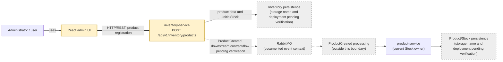

# CP1 — Product Registration Attack Surface

## 1. Context and scope

This analysis is limited to the reserved trust boundary:
**React admin UI → `inventory-service`, `POST /api/v1/inventory/products`**.
The browser-side administrator and the service-side API are on different trust
sides. The browser is user-controlled and sends data across an HTTP boundary;
the service is responsible for validating and persisting the product record.
The boundary therefore changes the trust level: request data must be treated as
untrusted until authenticated, authorized, validated, and safely persisted.

The registration payload crosses the boundary with `code`, `name`,
`category`, `shade`, `purchasePrice`, `salePrice`, and `initialStock`.
`inventory-service` owns product information and immutable `initialStock`.
`product-service` owns current stock. `ProductCreated` publication and its
downstream processing are outside this boundary; they are shown only as
system context.

The local workspace does not contain a checkout of `code-corhuila/bysellens-docs`.
Consequently, the external architecture, product, and OpenAPI documents could
not be independently inspected here. Statements below are limited to the
local workshop record and explicitly mark unresolved details.

## 2. Data-flow diagram

The solid double arrow is the reserved boundary. The dashed links represent
documented context whose implementation, deployment, or exact message
connection remains pending verification. No external API or port is added
because none is documented in the local workspace. The diagram was checked
for balanced Mermaid syntax manually; no Mermaid renderer is installed, so
rendering was not independently verified.

## 3. Assets

| Asset | Location / owner | Classification | Proposed rationale |
|---|---|---|---|
| Product code | `inventory-service` registration record | internal | Domain data needed by internal services; not necessarily public. |
| Product name and category | Registration payload and Inventory record | public | Product catalogue information may be displayed to administrators or users. |
| Product shade | Registration payload and Inventory record | public | Catalogue attribute without an identified secret. |
| Purchase price | Registration payload and Inventory record | confidential | Commercial cost information should not be exposed broadly. |
| Sale price | Registration payload and Inventory record | confidential | Pricing information can affect business decisions and must be access-controlled. |
| `initialStock` | Inventory product record | restricted | Inventory quantity is operationally sensitive and is the initial stock input, not current Stock. |
| Product registration authorization | HTTP request to `inventory-service` | restricted | JWT claims and ADMIN authorization determine who may create products. |

These classifications are analysis proposals, not labels verified in a
deployed policy or data-classification registry.

## 4. Entry point at the reserved boundary

| Field | Documented or known detail |
|---|---|
| Method and endpoint | `POST /api/v1/inventory/products` |
| Sender | React administrator UI |
| Receiver | `inventory-service` |
| Data | `code`, `name`, `category`, `shade`, `purchasePrice`, `salePrice`, `initialStock` |
| Protocol and port | HTTP/REST is the documented style; port is not available in the local sources |
| Authentication | Architecture documentation is recorded as requiring JWT validation; actual enforcement is not verified locally |
| Authorization | Architecture documentation is recorded as requiring `ADMIN`; actual enforcement is not verified locally |
| OpenAPI security | The documented discrepancy is `security: []`; this is unresolved documentation, not a confirmed vulnerability |
| Persistence responsibility | `inventory-service` records product data and `initialStock`; `product-service` owns current Stock |

## 5. Controls and open questions

**Required by documentation, not verified in code or execution:** JWT
validation, ADMIN authorization, server-side validation of the registration
fields, and the Inventory/Product ownership separation.

**Verified locally:** the Week 13 CP0 README records the boundary and payload
scope. No implementation of the real `inventory-service`, endpoint execution,
OpenAPI runtime, database, or authorization middleware is present in this
workspace. The Week 11 journey documents Product and Inventory as separate
services and distinguishes current Stock from `initialStock`, but it is a
target design rather than a running system.

**Questions to resolve:** Which deployed component terminates HTTP? Which port
and base URL are used? Where are JWT signature, expiry, issuer, and audience
checked? Where is the ADMIN role enforced? Which fields and price/stock ranges
are validated? What database and transaction boundary store the record? Which
event envelope and broker routing key carry `ProductCreated`?

## 6. References

- [Week 13 CP0 README](./README.md), `CONFIG-START`, `BOUNDARY`, `Scope`, and
  `Pending information`; local repository commit `2f6d076273cb16a1ce97281906b307a2c605633e`.
- [Week 11 journey](../../11-week/workshop/01-journey.md), `Journey` and
  `Hops`; local repository commit `2f6d076273cb16a1ce97281906b307a2c605633e`.
  It records the service ownership distinction and event context, not this
  registration endpoint.
- Issue reservation:
  <https://github.com/code-corhuila/bysellens-docs/issues/54>.
- The configured external documentation source is
  <https://github.com/code-corhuila/bysellens-docs>, but its architecture,
  product, and contract files were not present locally and were not claimed as
  independently verified.
